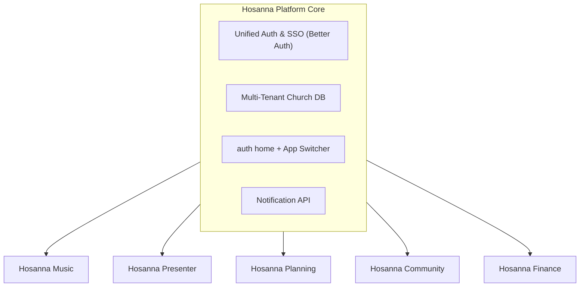
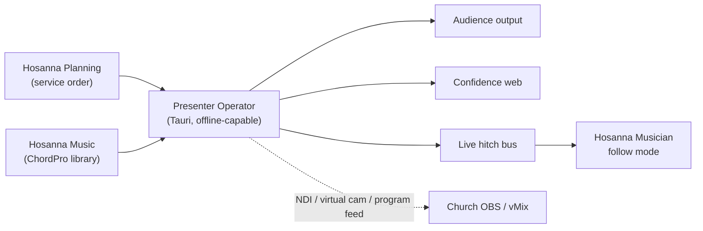
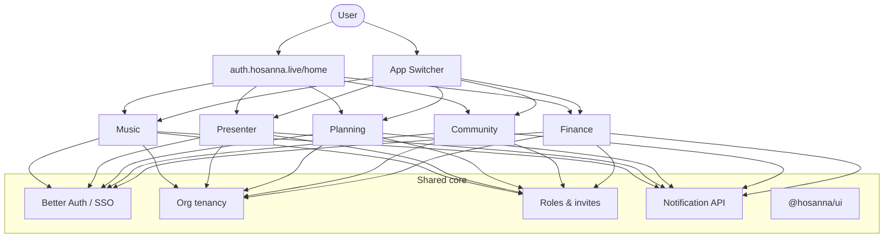
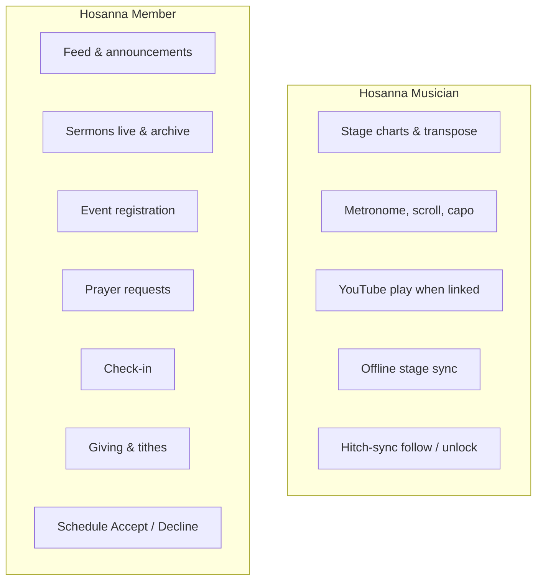

# Hosanna: Future Vision & Ecosystem Architecture

## 1. Executive Summary

Hosanna is growing from a worship songbook and service-planning tool into a modular **Church Operating Suite**: focused apps that share one account system, one church database, a post-login **home** on the auth site, and a Google-style **App Switcher** on every app.

The suite stays open and practical for churches of every size. Product work also includes stronger branding (new primary logo and a distinct mark per app) and a likely subscription adjustment (for example from \$12 to \$14).



---

## 2. Current State vs. Future Architecture

### Today

- **Hosanna Mobile (Musician)**: Stage tool — ChordPro, transpose, capo, metronome, auto-scroll, chord diagrams, offline sync.
- **Hosanna Studio (Web)**: Music library (ChordPro, collections, AI import) and services/agendas in one product.

### Future

Services and scheduling move into **Planning**. Studio is renamed **Hosanna Music** and stays the song and repertoire product. Four more products join the suite around the same org and auth.

| App                   | Primary audience                         | Mission                                                                                                 |
| :-------------------- | :--------------------------------------- | :------------------------------------------------------------------------------------------------------ |
| **Hosanna Music**     | Worship leaders, vocalists, band         | Songs, collections, sheets, libraries, stage-oriented charts                                            |
| **Hosanna Presenter** | Media & tech teams                       | Native desktop show control — lyrics, media, screens, stream feed; ChordPro-native and Music hitch-sync |
| **Hosanna Planning**  | Service & ministry leads, facility leads | Calendar-first services & events, teams, rooms & resources                                              |
| **Hosanna Community** | Pastors, staff, members (via Member app) | People/CRM, posts & sermons, forms, prayer, check-in                                                    |
| **Hosanna Finance**   | Treasurers, admins, donors               | Giving, funds, budgets, expenses, statements                                                            |

---

## 3. The App Suite

### 3.1. Hosanna Music

The song and repertoire product — what Studio does today for music, without owning services.

**Owns**

- ChordPro authoring and formatting; collections and church song libraries
- Optional arrangements: a song may have one chart or many variants (different full charts, or simple key changes — up to the editor)
- Metadata such as original key, tempo, time signature, and a YouTube link on the song; in the Musician app a link becomes a play control in the spirit of a streaming player
- AI sheet / PDF import where it already helps — useful, not the center of the product
- SongSelect-oriented import paths and **CCLI reporting**: the church stores its license number; usage comes from songs attached to services in the database so reporting can run without re-entering setlists
- Open ChordPro export

**Does not own**

- Service building, rosters, or agendas (Planning). Planning stores **song IDs** only and reads catalog data from Music.
- A public song gallery. A later option may be hosting **open-licensed** songs that churches can import into their own library — nothing beyond that.

---

### 3.2. Hosanna Presenter

Native **Tauri** booth software for near full media show control. Planning and Music prepare the service and catalog; Presenter runs the live outputs.

**Operator (desktop)**  
Booth control: service run, go-live, outputs, media, and live authority. After sync, the Operator runs the service offline; **sync** is what needs connectivity. During a live service the Operator is the source of truth.

**Confidence web (companion)**  
A scoped browser companion — not a second Presenter. Live annotations on what is showing, and advance only when the booth operator allows it.



**Service content**

The Operator loads the Planning service order and expands each item into slides or cues. Lyric slides come from Hosanna Music ChordPro (or a Presenter-specific variant when one exists) — not a separate plaintext lyric library.

| Item type         | Behavior                                                                                                                                            |
| :---------------- | :-------------------------------------------------------------------------------------------------------------------------------------------------- |
| **Songs**         | Lyric slides from Music ChordPro (sections / verses), or a Presenter-specific variant                                                               |
| **Bible**         | Built-in translations; packs downloaded per church and cached offline                                                                               |
| **Images**        | Library or folder slideshow with simple transitions                                                                                                 |
| **Video / audio** | Local media and loops, with preview before go-live                                                                                                  |
| **Slides**        | Hosanna Canvas scenes (web-authored, simple built-in animations) as the native slide format; PPTX / PDF import converts into Canvas or a slide grid |
| **Website**       | Audience display of a URL (announcements, giving, related pages)                                                                                    |
| **Screen share**  | Operator or guest share into Audience (LAN-first)                                                                                                   |
| **Alerts**        | Lower-third and lower popups (names, welcome, urgent notices) as non-blocking overlays                                                              |
| **Timer**         | Countdown / count-up on Confidence (optionally Audience), with optional Operator-controlled worship-pad / bed audio                                 |

**Outputs**

- **Audience** — lyrics, Scripture, Canvas / slides, media, website, screen share, alerts, and live annotate overlays
- **Confidence** — current and next cue, clocks, private booth cues, annotations, optional advance when granted
- **Program feed** — NDI, virtual camera, or clean program window into the church’s existing OBS / vMix → YouTube pipeline

**Audience annotate**  
From the Confidence companion or Operator, draw and highlight on the live Audience projection (e.g. circle a verse). Overlays are session-scoped unless the Operator saves them. Separate from Musician chart annotations in Music.

**Musician hitch-sync**  
Presenter publishes live position on the hitch bus. Hosanna Musician jumps to the active song, follows the matching ChordPro section / verse as lyric slides advance, and offers follow mode with local unlock so a musician can leave sync without changing booth state. Remotes and hitch followers consume Operator state; Musician unlock is device-local only.

**Access**  
Any signed-in account that belongs to the org can use it under the same church subscription — no per-seat Presenter license.

**Service video today and later**  
Organizers publish sermon links in Community (**Live** and **Archive**, plus optional audio); Community and the Member app surface Watch Live and the archive. Presenter contributes to that stream by exposing a program feed into OBS / vMix.

A separate **Hosanna Live** capability (ingest camera, program, and house audio; encode and distribute to YouTube and the Member app) remains a later vision only — not decided for shipping with Presenter, and kept decoupled from the offline Operator path.

---

### 3.3. Hosanna Planning

Operational planning for church life. The home surface is a **calendar** where staff create **services** and **events** (filters and colors distinguish them).

**Services and events**

- Creating a **service** also creates its linked **event**. From the service, that linked event is editable with mostly the same fields as a standalone event, plus service-oriented extras and values pre-filled from a template
- Standalone events (retreats, camping, conferences, rehearsals, and the rest) use the same event model with **no** service link
- Events publish into Community for the member-facing calendar and detail pages. Registration (including price and related booking fields set at create time) happens in the **Member app**
- Run-of-show (order, timings, notes, Music song IDs) is a first-class capability of a service, not a separate product
- Planning publishes the plan; it does **not** run a live “behind/ahead” clock — that is not its job

**Templates**

- One template model for both. A **service template** is an event template marked for services
- Templates can carry responsibilities/teams, default rooms, and default resources
- Recurrence is template-driven: stamp out instances from a template — not a separate “edit this occurrence / edit the series” engine

**People and teams**

- People join the org with accounts, can belong to several orgs, and join **teams**
- Scheduling flows (including Accept / Decline on the Member app) hang off that membership model

**Rooms and resources**

Managed in their own tabs, then requested from events or by people directly.

- **Resources** — description, inventory **amount**, optional approval (a role and/or a named person). Events or individuals request quantities; the system tracks what is allocated and warns when requests exceed what is free
- **Rooms** — same request and approval model, with **capacity** instead of amount. Events or individuals can request a room; ad-hoc person requests appear on the calendar as blocks
- **Maintenance / temporary blocks** — rooms and resources can be blocked for maintenance or similar; blocked inventory cannot be requested while the block is active
- **Usage log** — rooms and resources keep a use history (who/what/when) without turning Planning into a full CMMS
- Conflicts across rooms, gear, and people surface as **warnings**

**Integrations**

- Music: setlists reference song IDs
- Presenter and Musician consume the plan and catalog elsewhere
- Reminders and alerts go through the shared **notification API**, not a Planning-only stack

---

### 3.4. Hosanna Community

Staff-facing church life and CRM on the web for now. **Member-facing interaction is the Hosanna Member app** (and anonymous entry via the church public QR). Community is where staff manage people, publish content, run check-in, and configure engagement.

Three domains:

**People**

- **Persons** on a modular, easy-to-extend profile model: contact fields, custom fields, tags/segments, membership status, milestones (e.g. baptism), and whatever the church adds later without a schema rewrite
- **Lifecycle** — starts anonymous (e.g. QR / guest), can become a signed-in **user**, then a **member** of the church
- **Households** — a unit of people (family/household) used where the church thinks in groups of related persons
- **Private notes** — staff-only notes on a person
- **Groups and classes** — small groups, life groups, and classes (e.g. Sunday kids class) as first-class rosters staff manage in Community

**Content**

- **Posts** — staff/admins only; Markdown in a rich editor (formatting, media, links — the full editor feature set). No comments
- **Sermons** — authored in Community; the Member app plays them. One sermon record can carry **video** and **audio** (podcast) links, series/speaker/scripture-style metadata, and **public notes** (Markdown the pastor writes for everyone on that sermon — bullet points, outline, etc.)
  - **Series** — first-class (ordered list, artwork, and the sermons that belong to it)
  - **Live** — upcoming or in-progress stream; Member app shows Watch Live treatment
  - **Archive** — past recording kept as a library resource
- Churches publish media links manually (e.g. YouTube for video, podcast/host URL for audio)

**Engagement**

- **Events** — read-only mirror of Planning (calendar, detail, price/booking). Registration stays in the Member app
- **Forms** — staff-authored forms members (and guests) can submit from the Member app
- **Prayer requests** — anyone may submit, including anonymous. Visibility defaults to leaders and assigned people; those people can **publish** a request onto a prayer wall when appropriate
- Notifications via the shared notification API
- **Check-in and attendance** — Community admin owns check-in and reports; Member app is the pass / QR surface
  - Member attendance at services, events, groups, and classes
  - Children’s check-in: children, guardians, authorized pickups, classroom assignment
  - Volunteer check-in for ministry participation
  - Attendance from check-in when possible, with manual headcount as a fallback; records tie to Planning services/events by ID
  - Attendance history and participation reporting

Wiki-style manuals and in-app team chat are **out**.

---

### 3.5. Hosanna Finance

Stewardship and books for people who need trust, history, and clarity.

**Giving**

- Online giving (including Stripe and Pix) plus manual cash, check, and envelope entry
- Anyone can give — members and guests
- Recurring and one-off gifts; members can set up tithes in the Member app
- Gifts land in an assigned destination; finance managers can reassign
- Campaign or event-linked giving when Community/Planning surfaces call for it

**Books and reporting**

- Designated funds and allocation
- Budgets and **expenses** (a principal part of the product, not an afterthought)
- Official tax / giving statements and periodic (e.g. semester) reports
- Treasurers, owners, and admins as the financial audience; every action keeps a history

**Board materials**

- Initially export charts and tables for external decks
- Later, optional handoff into Presenter for in-room financial presentations

---

## 4. Platform Core

Shared foundation so the suite feels like one product.



### 4.1. Auth home and App Switcher

Post-login **home** lives on the auth site at `auth.hosanna.live/home` — not a separate suite app. It lists the apps the user may open and supports switching org when they belong to more than one.

Every web app also carries a Google-style **App Switcher** (header grid) to move between products without returning to home. Presenter’s Operator is the desktop booth app; Confidence is the web companion — both sit under the same suite identity.

### 4.2. Auth and roles

Better Auth remains the identity layer. Roles move to a clearer model: a small set of **general** org roles, plus **per-app** roles assigned on invite.

### 4.3. Notifications

Push, email, and later WhatsApp/SMS are capabilities of one **notification API**. Any app can trigger delivery; no single product owns the pipe.

### 4.4. Monorepo shape

```
hosanna/
├── apps/
│   ├── web-music/
│   ├── web-planning/
│   ├── web-community/
│   ├── web-finance/
│   ├── desktop-presenter/      # Tauri Operator
│   ├── web-presenter/          # Confidence companion (+ any Operator-served web surfaces)
│   ├── mobile-musician/
│   ├── mobile-member/
│   └── api/                    # may later split (e.g. community vs internal) if the data plane demands it
├── packages/
│   ├── ui/
│   ├── auth/
│   ├── db/
│   ├── notifications/
│   ├── chordpro/
│   ├── presenter-core/         # Service-run model, slide plugins, hitch protocol, canvas
│   └── types/
├── package.json
└── turbo.json
```

---

## 5. Mobile

Two apps, on purpose.



**Hosanna Musician** — authenticated band/stage use; dark, high-contrast, offline-first charts and tools; hitch-sync follow with local unlock when Presenter is live.

**Hosanna Member** — congregation and volunteers. Sign in to the church **or** enter through the church’s **public QR** for anonymous access. Surfaces feed, sermons (live, archive, audio, public notes), event registration/booking from Planning, forms, prayer requests (and the published prayer wall), check-in, giving/tithes, and schedule Accept/Decline. It talks to Community, Planning, and Finance APIs; it is not a third admin console.
