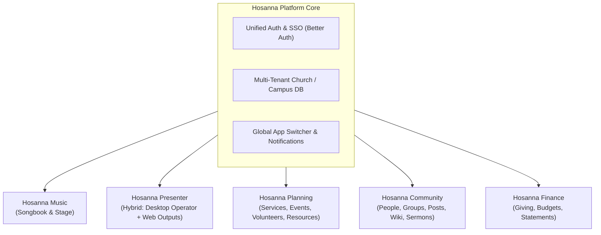
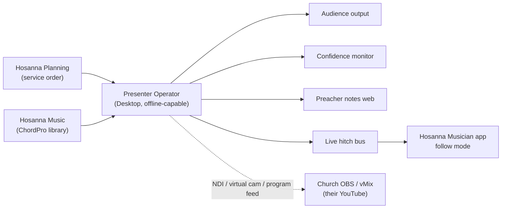
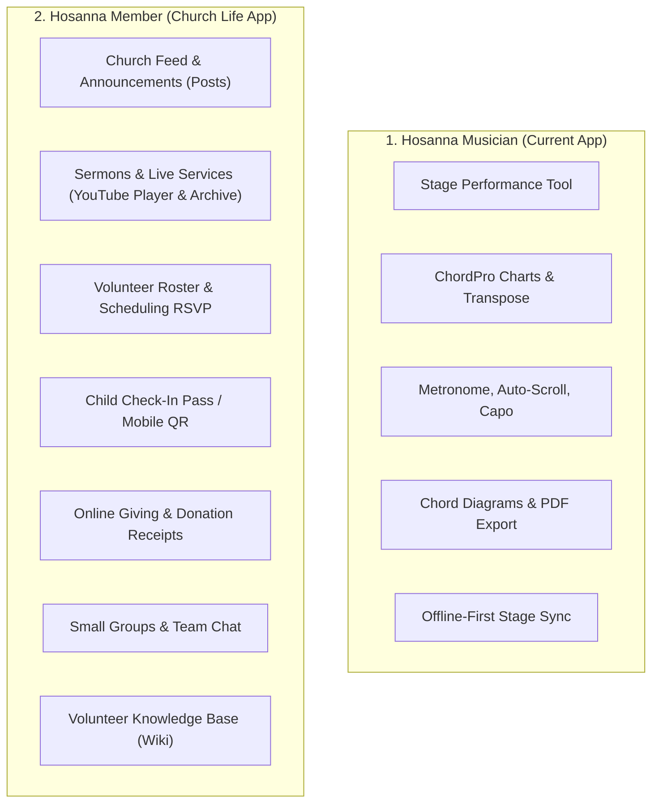
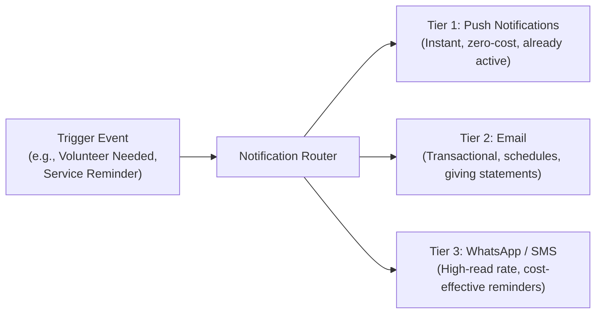
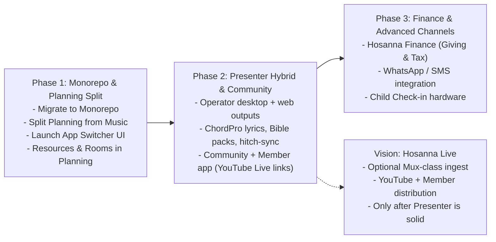

# Hosanna: Future Vision & Ecosystem Architecture

## 1. Executive Summary

Hosanna is evolving from a focused **worship songbook and service planning tool** into a comprehensive, modular **Church Operating Suite**.

Rather than building a single monolithic application that attempts to do everything in one cluttered interface, the future of Hosanna is an **integrated ecosystem of focused apps** connected by a unified account system, shared church database, and a global **App Switcher** (similar to Google Workspace or the Planning Center model, but open, modern, and accessible for churches of all sizes).



---

## 2. Current State vs. Future Architecture

### Today: Two-Component Architecture

- **Hosanna Mobile**: Dedicated stage tool for musicians (ChordPro charts, transpose, capo, metronome, auto-scroll, chord diagrams, offline sync).
- **Hosanna Studio (Web)**: Dual-purpose dashboard handling both **Music Library** (ChordPro management, collections, AI import) and **Services/Agendas** (setlist order, notes, schedules).

### Future: Decoupled 5-App Ecosystem

The services, agendas, and scheduling will be extracted out of Hosanna Studio and elevated into a dedicated **Planning** app (which also houses full resource, room, and equipment management). The original Hosanna will double down on being the premier **Music & Repertoire Engine**.

| App                                 | Primary Audience                                                        | Core Mission                                                                                                            |
| :---------------------------------- | :---------------------------------------------------------------------- | :---------------------------------------------------------------------------------------------------------------------- |
| **Hosanna Music** _(Basic Hosanna)_ | Worship leaders, vocalists, band musicians                              | Song repository, ChordPro charts, audio attachments, stage tools.                                                       |
| **Hosanna Presenter**               | Media & tech teams, projectionists                                      | Hybrid live presentation: offline-capable desktop Operator + web Audience / Confidence / Preacher notes; ChordPro-native lyrics and Music hitch-sync. |
| **Hosanna Planning**                | Service leaders, event coordinators, ministry directors, facility leads | Liturgy/order of service, volunteer scheduling, rehearsal & event planning, **rooms, vehicles, and equipment booking**. |
| **Hosanna Community**               | Pastors, small group leaders, members, families                         | Member directory, families, check-in, groups, church news (Posts), knowledge base (Wiki), sermons/live video, chat.     |
| **Hosanna Finance**                 | Treasurers, finance committees, donors                                  | Tithes & offerings, donor statements, budget tracking, fund allocation.                                                 |

---

## 3. Deep-Dive: The App Suite Breakdown

### 3.1. Hosanna Music (The Core Songbook)

_The dedicated music and repertoire engine for worship teams._

- **Scope & Focus**:
  - ChordPro song authoring, editing, and formatting.
  - Multi-key arrangements, original keys, vocal ranges, tempo (BPM), and time signature.
  - Integration with audio files, backing tracks, and YouTube references.
  - Mobile & tablet stage mode: per-musician transpose, capo, chord hiding, auto-scroll, metronome, guitar/piano chord diagrams.
  - AI sheet music / chord scan and PDF import.
  - Open ChordPro export and sharing.
- **What changes**:
  - Service building, team rosters, and agenda items move to **Hosanna Planning**. Hosanna Music provides the song catalog API that Planning consumes.

---

### 3.2. Hosanna Presenter (Projection & Media — Hybrid)

_Modern church presentation software. Product inspirations: [Church Presenter](https://www.churchpresenter.org/), [TheOpenPresenter](https://theopenpresenter.com), OpenLP, ProPresenter — with Hosanna’s wedge being **ChordPro-native lyrics** and **live hitch-sync with Hosanna Music**._

Presenter is a **separate product** (never a Studio tab that drives projectors). Studio / Planning **prepare** the service; Presenter **runs** it on Sunday.

#### Architecture (hybrid)

| Surface | Form factor | Role |
| :------ | :---------- | :--- |
| **Operator** | Native desktop (Tauri / Electron), offline-first | Booth control: service run, go-live, outputs, media, authority |
| **Audience** | Web renderer (browser / TV stick / Chromecast-class) or desktop-owned window | What the congregation sees |
| **Confidence** | Web renderer (one shared layout for band + pulpit) | Current + next, clocks, cues |
| **Preacher notes** | Web surface (tablet/laptop URL; OpenPresenter-style remote, hosted by Presenter’s local/cloud server) | Speaker notes + optional live annotate controls — **not** a fourth native app |
| **Remote assist** | Phone/tablet web | Advance only if Operator grants; **Operator always wins** conflicts |



- **Offline Sunday is a hard requirement** for the Operator: after sync, the booth machine must run the service if church Wi‑Fi dies.
- **Live authority**: Presenter Operator is source of truth during the service. Remotes and hitch followers are slaves unless the Operator releases control.
- **Code strategy**: Prefer reusing battle-tested open presentation patterns (notably TheOpenPresenter’s remote/renderer/plugin ideas and Church Presenter’s Sunday-practical feature set) plus AI-assisted ports — **not** casually merging AGPL code into the commercial SaaS monorepo without a deliberate license isolation plan (TheOpenPresenter is AGPL-3.0). Treat upstream as inspiration / carefully bounded dependency, not a silent copy-paste into proprietary apps.

#### Content types (service item plugins)

A live service is an ordered list of items (from Planning) that the Operator can expand into slides/cues:

| Item type | Behavior |
| :-------- | :------- |
| **Songs** | Lyrics derived from **ChordPro** (Hosanna Music) — verse/chorus slides, not retyped plaintext |
| **Bible** | Church **downloads** the translations they want; Presenter caches them for offline use |
| **Images** | Folder/library slideshow with simple transitions |
| **Video / audio** | Local media + loops; preview before go-live |
| **Slides** | Prefer **Hosanna Canvas** (web-authored scenes with simple built-in animations) as the primary sermon/announce path; **PPTX/PDF import** as a conversion/import path into Canvas or a slide grid — not a full Office engine in-process |
| **Website** | Show a URL (announcements, giving page, livestream backstage) on Audience |
| **Screen share** | Operator or guest share into Audience (LAN-first) |
| **Alerts** | Lower-third / lower popups (names, emergency, “welcome guests”) — non-blocking overlays |
| **Timer** | Countdown/count-up on Confidence (and optionally Audience); optional **background worship pad / bed music** under the Operator’s control |

#### Outputs

- **Audience**: lyrics, Scripture, canvas/slides, media, website, screen share, alerts.
- **Confidence (single layout)**: high-contrast current + next, stage clock, service timer, private booth→stage cues. One layout for band and preacher (avoid layout sprawl in v1).
- **Program / stream helper (not Hosanna Live)**: NDI, virtual camera, or clean program window for churches that already run OBS → YouTube. Presenter does **not** host the livestream in early phases.

#### Live annotate (Audience)

Preacher (or Operator) can draw/highlight **on the live Audience projection** (circle a verse, underline a lyric). Annotations are ephemeral session overlays unless explicitly saved. This is distinct from Musician song annotations in Hosanna Music.

#### Musician hitch-sync (Hosanna’s unfair wedge)

While Presenter advances the service:

1. Musician app can **jump to the active song**.
2. Within a song, advance can **jump to the matching section/verse** (ChordPro structure ↔ Presenter lyric slides).
3. **Follow mode** is optional — musician may **unlock** to navigate independently without fighting the booth.

Presenter remains source of truth; unlock is local to the musician device.

#### Presenter roadmap layers (build order)

1. **Operator core**: service run from Planning, ChordPro lyrics, Bible (downloadable packs), images, go-live Audience + Confidence, offline cache, Operator authority.
2. **Media & overlays**: video/audio, alerts, timers (+ optional worship pad), website item, screen share.
3. **Canvas & import**: web Canvas authoring + simple animations; PPTX/PDF import into that model.
4. **Hitch-sync + preacher web**: Musician follow/unlock; preacher notes URL; Audience annotate.
5. **Program out**: NDI / virtual cam for existing church streaming setups.

---

### 3.2.1. Live video — near-term vs vision _(not Presenter MVP)_

**Near-term (keep it simple):** do **not** build Mux ingest yet. The person organizing the stream publishes a **YouTube Live** (or VOD) link into **Hosanna Community**; Member app / Community shows “Watch Live” and the sermon archive. Presenter only supplies a clean **program feed** into the church’s OBS if they want overlays/lyrics on that stream.

**Vision only — optional future “Hosanna Live”:** a separate product (or Community module) that could ingest camera + presentation program + house audio, encode via something like Mux, and distribute to YouTube + Member app. Treat as post–Presenter-stability vision: cost, bandwidth, support, and liability are real. Prefer a **separate Live app/module** if it ever ships, so Presenter’s Sunday reliability is never coupled to cloud encode.

Decision rule: if Live distracts from a booth that always works offline, defer Live.

---


### 3.3. Hosanna Planning (Services, Events, Volunteers & Resources)

_The central operational calendar, volunteer engine, and facility scheduler for church life._

- **Scope & Focus**:
  - **Service Order (Order of Worship / Liturgy)**:
    - Detailed run-of-show with item durations, leader assignments, technical notes, and song setlists imported from Hosanna Music.
    - Real-time live service progress tracker (clock tracking whether the service is on time, behind, or ahead).
  - **Beyond Sunday Services (Events & Rehearsals)**:
    - Planning for mid-week rehearsals, conferences, youth meetings, prayer nights, and special outreach events.
    - Master church calendar with conflict-free scheduling across all ministries.
  - **Volunteer Scheduling & Matrix**:
    - Roster creation across multiple ministries (Worship, Tech/AV, Ushers, Kids, Hospitality).
    - Volunteer invitation workflows (Accept / Decline / Swap requests).
    - Block-out dates (volunteers specify when they are unavailable).
    - Automated reminders via push notifications, email, and WhatsApp/SMS.
  - **Facilities & Resource Management (Merged into Planning)**:
    - **Rooms & Spaces**: Sanctuary, fellowship hall, classrooms, nursery, youth room.
    - **Vehicles**: Church vans, buses, utility trailers.
    - **Equipment & Gear**: Projectors, wireless microphones, portable PA systems, tables, folding chairs, communion sets.
    - **Conflict Detection Engine**: When an event or service is scheduled, rooms and equipment are reserved simultaneously. The system blocks double-booking automatically.
    - **Approval Workflows**: Set optional approval requirements (e.g., facility manager must approve van or fellowship hall bookings).
  - **Integration with Presenter & Music**:
    - As soon as a service plan is finalized in Planning, the song setlist is instantly available on musicians' mobile devices (Music) and ready in the booth (Presenter).

---

### 3.4. Hosanna Community (People, Families, Groups & Knowledge)

_The relational heartbeat and member management of the church._

- **Scope & Focus**:
  - **People & Directory**:
    - Member and guest profiles, contact information, spiritual milestones (baptism, membership status), pastoral notes, and interaction history.
  - **Families & Households**:
    - Grouping people into households, tracking parent-child relationships, emergency contacts.
  - **Check-In & Attendance**:
    - Secure kids check-in with printed security labels/stickers, mobile barcode check-in, and volunteer check-in.
    - Headcount tracking for services and gatherings.
  - **Groups & Registrations**:
    - Small groups, life groups, classes, and Bible study management.
    - Public and private event registrations with capacity limits.
  - **Communication**:
    - Direct messaging, bulk emails, and WhatsApp/SMS announcements to specific segments (e.g., all parents, all youth, entire church).
  - **Posts (Church News, Bulletins & Updates)**:
    - Centralized church newsfeed for announcements, prayer requests, and event highlights.
    - Replaces scattered social media posts or lost WhatsApp announcements with an official feed.
  - **Sermons & Service Video Archive (YouTube Integration)**:
    - Dedicated media library for live streams and past recorded services (hosted on YouTube, played natively in-app).
    - Categorized by **Sermon Series**, **Speaker/Pastor**, **Scripture Reference**, **Topic**, and **Date**.
    - Live service badge: when a Sunday service is streaming live on YouTube, a prominent "Watch Live" banner appears at the top of the app.
  - **Wiki (Volunteer Knowledge Base & Ministry Manuals)**:
    - Empower volunteers to serve with confidence: sound booth SOPs, usher protocols, kids safety guidelines, worship team expectations.
    - Searchable, living documents organized by ministry department.
  - **Chat (Team Collaboration)**:
    - Optional in-app channels and direct messages for ministry teams (sound crew, worship band, small group leaders) to communicate without leaving the platform.

---

### 3.5. Hosanna Finance (Giving & Stewardship)

_Financial tracking and donor management built for trust and transparency._

- **Scope & Focus**:
  - **Giving & Donations**:
    - Online giving via Credit Card, Debit, and local payment methods (Pix, bank transfers, Stripe/custom gateways).
    - Recurring tithes and one-time campaign contributions.
    - Manual entry for cash, envelope, and check offerings.
  - **Donor Management**:
    - Giving history per person or family (integrated with Community).
    - Automated end-of-year tax receipts and giving statements.
  - **Fund & Budget Tracking**:
    - Allocation into designated funds (Tithe, Building Fund, Missions, Benevolence).
    - Budget monitoring vs. actual expenditures.
    - Financial reporting for pastoral leadership and church board review.

---

## 4. Platform Core: The Multi-App Foundation

To make multiple apps feel like **one unified product**, the underlying architecture must support:


### 4.1. Monorepo Architecture (Turborepo / pnpm)

The entire Hosanna suite will transition into a structured monorepo:

```
hosanna/
├── apps/
│   ├── web-music/             # Hosanna Music (Songbook, ChordPro, arrangements)
│   ├── web-planning/          # Hosanna Planning (Services, calendars, volunteer matrix, resources)
│   ├── web-community/         # Hosanna Community (People, check-in, posts, wiki, media)
│   ├── web-finance/           # Hosanna Finance (Giving, donor statements, budgets)
│   ├── desktop-presenter/     # Presenter Operator (Tauri/Electron shell, offline booth)
│   ├── web-presenter/         # Audience / Confidence / Preacher notes / remote renderers
│   ├── mobile-musician/       # Hosanna Musician App (Stage tool, ChordPro, hitch-sync)
│   ├── mobile-member/         # Hosanna Member App (News, check-in QR, giving, RSVP)
│   └── api/                   # Unified backend API server
├── packages/
│   ├── ui/                    # Shared design system, Tailwind config, Radix components
│   ├── auth/                  # Better Auth configuration, session helpers, SSO logic
│   ├── db/                    # Prisma schema, migrations, PostgreSQL client
│   ├── notifications/         # Push (FCM/APNS), Email (Resend/SES), WhatsApp/SMS router
│   ├── chordpro/              # ChordPro parser, transposition, formatting engine
│   ├── presenter-core/        # Service-run model, slide plugins, hitch protocol, canvas
│   └── types/                 # Shared TypeScript models and API contracts
├── package.json
└── turbo.json
```

---

### 4.2. Two-App Mobile Strategy

Rather than crowding every feature into a single cluttered app, Hosanna will provide **two specialized mobile experiences**:



1. **Hosanna Musician (Stage App)**:
   - Built specifically for the stage and rehearsal room.
   - Clean, dark-mode prioritized, high-contrast, distraction-free.
   - Dedicated tools: live transposition, capo, chord hiding, auto-scroll with speed tap, metronome, pedal board sync, and offline reliability.
2. **Hosanna Member (Church Life App)**:
   - Built for the congregation, parents, volunteers, and leaders.
   - Church news and announcements (**Posts**).
   - **Sermons & Live Services**: In-app YouTube playback for live Sunday service broadcasts and a searchable archive of past sermons (by series, speaker, and topic) with notes.
   - Volunteer invites with 1-tap Accept/Decline and block-out dates (**Planning RSVP**).
   - Touchless barcode / QR code for family security and child check-in (**Community**).
   - Quick tithes, pledges, and year-end statements (**Finance**).
   - Ministry manuals and standard operating procedures (**Wiki**).

---

### 4.3. Multi-Channel Notification Engine

Church communication must reach volunteers and members where they are. The notification pipeline operates on a prioritized routing tier:



- **Current State**: Push notifications are fully active; Email infrastructure is technically ready.
- **Future Expansion**: Add WhatsApp Business API / cost-effective SMS integration (evaluating regional pricing, e.g., WhatsApp Cloud API vs. SMS) specifically for:
  - Last-minute schedule changes and call times.
  - Sunday morning volunteer reminders.
  - Urgent pastoral announcements.

---

## 5. Phased Implementation Roadmap



### Phase 1: Monorepo Setup & Planning Split

- **Monorepo Transition**: Reorganize existing code into Turborepo with shared `@hosanna/ui`, `@hosanna/auth`, and `@hosanna/db`.
- **Decouple Planning from Music**: Extract services, setlists, and agendas from Hosanna Studio into **Hosanna Planning**.
- **Launch Global App Switcher**: Header component across apps for instant navigation.
- **Implement Resources inside Planning**: Allow reserving sanctuary, rooms, vans, and AV equipment during event/service scheduling with conflict prevention.

### Phase 2: Presenter Hybrid & Community App

- **Build Hosanna Presenter (Hybrid)**:
  - Offline-first **Operator** desktop shell (Tauri / Electron) + local/cloud server for web surfaces.
  - Web **Audience** + single-layout **Confidence** + **Preacher notes** URL.
  - Service run from Planning; **ChordPro → lyric slides** from Music; downloadable Bible packs; images.
  - Operator authority; hitch-sync to Musician (song + section follow, unlock).
  - Then: media, alerts, timers/pads, website, screen share, Canvas (+ PPTX import), program/NDI out.
- **Build Hosanna Community**:
  - Member directory, families, and groups.
  - **Posts**: Digital bulletin and church newsfeed.
  - **Sermons & Media**: organizers publish **YouTube Live / VOD links**; Member app shows Watch Live + archive (no Mux ingest yet).
  - **Wiki**: Searchable volunteer SOPs and ministry training library.
- **Launch Hosanna Member Mobile App**:
  - Volunteer scheduling responses (Accept / Decline).
  - Church feed, giving access, and team communication.

### Phase 3: Finance, Communication Channels & Full Scale

- **Build Hosanna Finance**:
  - Payment gateway integration for online giving, tithes, and donor receipts.
  - Fund accounting and church budget tracking.
- **Activate WhatsApp / SMS Delivery**:
  - Add cost-effective WhatsApp/SMS fallback for automated volunteer reminders and urgent alerts.
- **Child Check-In Kiosks**:
  - Dedicated check-in mode with thermal label printing for child security tags.
- **Deepen Facility Operations in Planning**:
  - Add room setup diagrams, vehicle mileage logs, and equipment maintenance schedules directly inside Planning.

---

## 6. Architectural Decisions Log (Confirmed)

| Decision Area             | Chosen Strategy                                      | Rationale                                                                                                                                                                                                        |
| :------------------------ | :--------------------------------------------------- | :--------------------------------------------------------------------------------------------------------------------------------------------------------------------------------------------------------------- |
| **Presenter Delivery**    | **Hybrid: Desktop Operator + Web outputs**           | Booth needs offline multi-monitor reliability; Audience / Confidence / Preacher notes / remotes work best as browsers (TV sticks, tablets) like OpenPresenter — without making Studio the live engine.           |
| **Presenter Authority**   | **Tech Operator wins**                               | One booth source of truth during service; remotes and hitch followers are optional and subordinate.                                                                                                              |
| **Presenter Wedge**       | **ChordPro lyrics + Music hitch-sync**               | Differentiates from Church Presenter / OpenPresenter / ProPresenter: lyrics aren’t a second library; musicians can follow verse/section live.                                                                    |
| **Slide Authoring**       | **Canvas primary; PPTX import secondary**            | Avoid shipping a full PowerPoint engine; import into Hosanna Canvas with simple animations.                                                                                                                      |
| **Live Streaming**        | **Near-term: YouTube link in Community; vision: optional Hosanna Live** | Don’t couple Sunday Presenter to Mux. Churches stream with OBS; Community/Member embed YouTube. Mux-class ingest is vision-only, preferably a separate Live module later.                                      |
| **OpenPresenter reuse**   | **Patterns / careful isolation; respect AGPL**       | Useful remote/renderer/plugin ideas; AGPL-3.0 means no silent merge into proprietary SaaS — license strategy required before heavy code reuse.                                                                   |
| **Codebase Architecture** | **Monorepo (Turborepo / pnpm)**                      | Unifies shared UI tokens, Better Auth SSO, database models, and API clients across all apps while allowing independent deployments.                                                                              |
| **Mobile App Strategy**   | **Two Dedicated Mobile Apps**                        | Separates the stage performance tool (_Hosanna Musician_) from general congregation life, check-in, and church updates (_Hosanna Member_). Preacher notes stay a web surface, not a third mobile app.              |
| **Resource Placement**    | **Permanently Merged into Planning**                 | Keeps all operational scheduling (services, events, volunteers, rooms, vehicles, and equipment) in one cohesive planner with unified conflict prevention, keeping the suite strictly focused on 5 distinct apps. |
| **Notification Pipeline** | **Push (Current) + Email + WhatsApp/SMS (Upcoming)** | Maximizes deliverability and read rates for volunteer scheduling while optimizing messaging costs.                                                                                                               |
