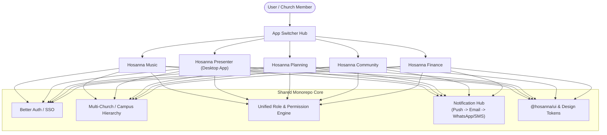
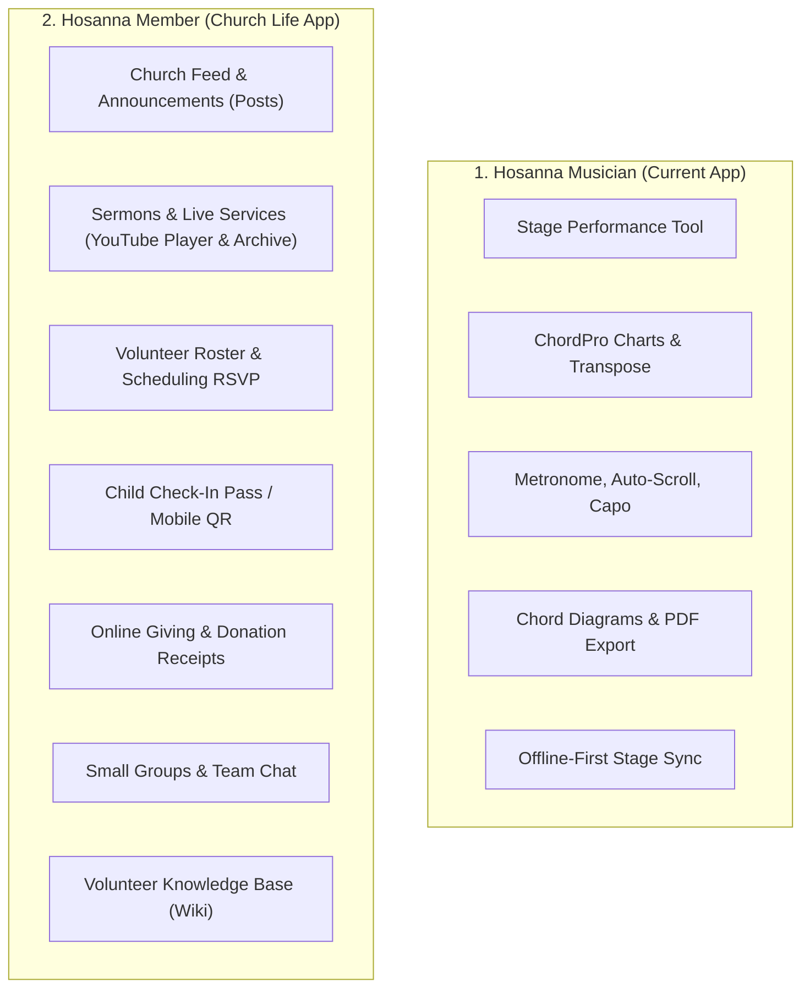
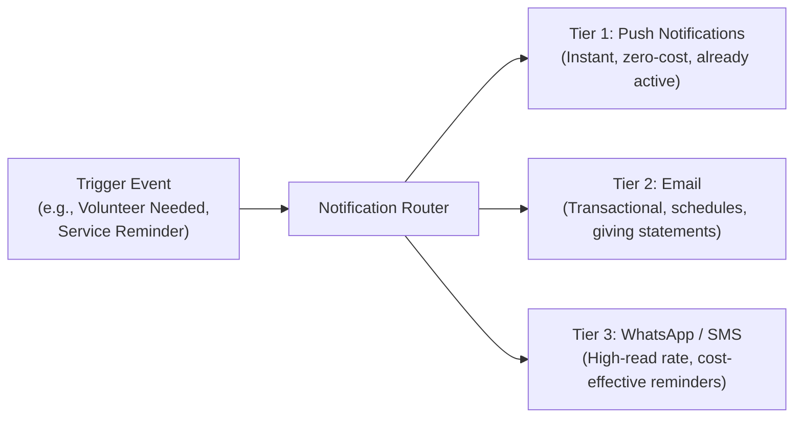
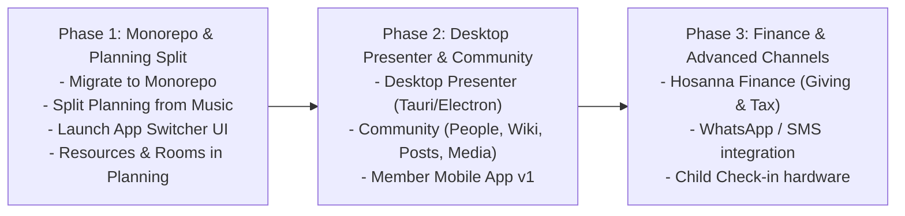

# Hosanna: Future Vision & Ecosystem Architecture

## 1. Executive Summary

Hosanna is evolving from a focused **worship songbook and service planning tool** into a comprehensive, modular **Church Operating Suite**.

Rather than building a single monolithic application that attempts to do everything in one cluttered interface, the future of Hosanna is an **integrated ecosystem of focused apps** connected by a unified account system, shared church database, and a global **App Switcher** (similar to Google Workspace or the Planning Center model, but open, modern, and accessible for churches of all sizes).


---

## 2. Current State vs. Future Architecture

### Today: Two-Component Architecture

- **Hosanna Mobile**: Dedicated stage tool for musicians (ChordPro charts, transpose, capo, metronome, auto-scroll, chord diagrams, offline sync).
- **Hosanna Studio (Web)**: Dual-purpose dashboard handling both **Music Library** (ChordPro management, collections, AI import) and **Services/Agendas** (setlist order, notes, schedules).

### Future: Decoupled 5-App Ecosystem

The services, agendas, and scheduling will be extracted out of Hosanna Studio and elevated into a dedicated **Planning** app (which also houses full resource, room, and equipment management). The original Hosanna will double down on being the premier **Music & Repertoire Engine**.

| App                                 | Primary Audience                                                        | Core Mission                                                                                                            |
| :---------------------------------- | :---------------------------------------------------------------------- | :---------------------------------------------------------------------------------------------------------------------- |
| **Hosanna Music** _(Basic Hosanna)_ | Worship leaders, vocalists, band musicians                              | Song repository, ChordPro charts, audio attachments, stage tools.                                                       |
| **Hosanna Presenter**               | Media & tech teams, projectionists                                      | Dual-screen/multi-output live presentation (lyrics, media, confidence stage monitors) as a native desktop app.          |
| **Hosanna Planning**                | Service leaders, event coordinators, ministry directors, facility leads | Liturgy/order of service, volunteer scheduling, rehearsal & event planning, **rooms, vehicles, and equipment booking**. |
| **Hosanna Community**               | Pastors, small group leaders, members, families                         | Member directory, families, check-in, groups, church news (Posts), knowledge base (Wiki), sermons/live video, chat.     |
| **Hosanna Finance**                 | Treasurers, finance committees, donors                                  | Tithes & offerings, donor statements, budget tracking, fund allocation.                                                 |

---

## 3. Deep-Dive: The App Suite Breakdown

### 3.1. Hosanna Music (The Core Songbook)

_The dedicated music and repertoire engine for worship teams._

- **Scope & Focus**:
  - ChordPro song authoring, editing, and formatting.
  - Multi-key arrangements, original keys, vocal ranges, tempo (BPM), and time signature.
  - Integration with audio files, backing tracks, and YouTube references.
  - Mobile & tablet stage mode: per-musician transpose, capo, chord hiding, auto-scroll, metronome, guitar/piano chord diagrams.
  - AI sheet music / chord scan and PDF import.
  - Open ChordPro export and sharing.
- **What changes**:
  - Service building, team rosters, and agenda items move to **Hosanna Planning**. Hosanna Music provides the song catalog API that Planning consumes.

---

### 3.2. Hosanna Presenter (Projection & Media - Native Desktop App)

_Modern church presentation software (inspired by OpenLP, ProPresenter, and Faithlife Presenter)._

- **Architecture**: **Native Desktop Application** (built with Tauri / Electron / Flutter Desktop) for zero-latency video rendering, offline-first reliability during live church services, and hardware-accelerated multi-display management.
- **Scope & Focus**:
  - **Multi-Screen Outputs**:
    - _Audience Display_: Clean lyrics, motion video backgrounds, Scripture verses, sermon slides, announcements, lower thirds.
    - _Stage Display (Confidence Monitor)_: High-contrast lyrics, current slide + next slide preview, stage clocks, countdown timers, private cues/messages from the sound booth to the band/speaker.
    - _Live Stream / NDI Output_: Transparent background or lower-third overlay for OBS/vMix integration.
  - **Offline-First & Local Cache**:
    - Runs completely offline once synced with local SQLite/cache — immune to church WiFi/internet drops on Sunday mornings.
  - **Deep Hosanna Sync**:
    - Automatically pulls songs and arrangements directly from Hosanna Music (no manual retyping of lyrics).
    - Automatically syncs with the live service order running in Hosanna Planning.
  - **Media Engine**:
    - Support for video loops, still backgrounds, Bible translations, and slide templates.
    - Remote control via local network / mobile app (allowing the speaker or worship leader to advance slides if needed).

---

### 3.3. Hosanna Planning (Services, Events, Volunteers & Resources)

_The central operational calendar, volunteer engine, and facility scheduler for church life._

- **Scope & Focus**:
  - **Service Order (Order of Worship / Liturgy)**:
    - Detailed run-of-show with item durations, leader assignments, technical notes, and song setlists imported from Hosanna Music.
    - Real-time live service progress tracker (clock tracking whether the service is on time, behind, or ahead).
  - **Beyond Sunday Services (Events & Rehearsals)**:
    - Planning for mid-week rehearsals, conferences, youth meetings, prayer nights, and special outreach events.
    - Master church calendar with conflict-free scheduling across all ministries.
  - **Volunteer Scheduling & Matrix**:
    - Roster creation across multiple ministries (Worship, Tech/AV, Ushers, Kids, Hospitality).
    - Volunteer invitation workflows (Accept / Decline / Swap requests).
    - Block-out dates (volunteers specify when they are unavailable).
    - Automated reminders via push notifications, email, and WhatsApp/SMS.
  - **Facilities & Resource Management (Merged into Planning)**:
    - **Rooms & Spaces**: Sanctuary, fellowship hall, classrooms, nursery, youth room.
    - **Vehicles**: Church vans, buses, utility trailers.
    - **Equipment & Gear**: Projectors, wireless microphones, portable PA systems, tables, folding chairs, communion sets.
    - **Conflict Detection Engine**: When an event or service is scheduled, rooms and equipment are reserved simultaneously. The system blocks double-booking automatically.
    - **Approval Workflows**: Set optional approval requirements (e.g., facility manager must approve van or fellowship hall bookings).
  - **Integration with Presenter & Music**:
    - As soon as a service plan is finalized in Planning, the song setlist is instantly available on musicians' mobile devices (Music) and ready in the booth (Presenter).

---

### 3.4. Hosanna Community (People, Families, Groups & Knowledge)

_The relational heartbeat and member management of the church._

- **Scope & Focus**:
  - **People & Directory**:
    - Member and guest profiles, contact information, spiritual milestones (baptism, membership status), pastoral notes, and interaction history.
  - **Families & Households**:
    - Grouping people into households, tracking parent-child relationships, emergency contacts.
  - **Check-In & Attendance**:
    - Secure kids check-in with printed security labels/stickers, mobile barcode check-in, and volunteer check-in.
    - Headcount tracking for services and gatherings.
  - **Groups & Registrations**:
    - Small groups, life groups, classes, and Bible study management.
    - Public and private event registrations with capacity limits.
  - **Communication**:
    - Direct messaging, bulk emails, and WhatsApp/SMS announcements to specific segments (e.g., all parents, all youth, entire church).
  - **Posts (Church News, Bulletins & Updates)**:
    - Centralized church newsfeed for announcements, prayer requests, and event highlights.
    - Replaces scattered social media posts or lost WhatsApp announcements with an official feed.
  - **Sermons & Service Video Archive (YouTube Integration)**:
    - Dedicated media library for live streams and past recorded services (hosted on YouTube, played natively in-app).
    - Categorized by **Sermon Series**, **Speaker/Pastor**, **Scripture Reference**, **Topic**, and **Date**.
    - Live service badge: when a Sunday service is streaming live on YouTube, a prominent "Watch Live" banner appears at the top of the app.
  - **Wiki (Volunteer Knowledge Base & Ministry Manuals)**:
    - Empower volunteers to serve with confidence: sound booth SOPs, usher protocols, kids safety guidelines, worship team expectations.
    - Searchable, living documents organized by ministry department.
  - **Chat (Team Collaboration)**:
    - Optional in-app channels and direct messages for ministry teams (sound crew, worship band, small group leaders) to communicate without leaving the platform.

---

### 3.5. Hosanna Finance (Giving & Stewardship)

_Financial tracking and donor management built for trust and transparency._

- **Scope & Focus**:
  - **Giving & Donations**:
    - Online giving via Credit Card, Debit, and local payment methods (Pix, bank transfers, Stripe/custom gateways).
    - Recurring tithes and one-time campaign contributions.
    - Manual entry for cash, envelope, and check offerings.
  - **Donor Management**:
    - Giving history per person or family (integrated with Community).
    - Automated end-of-year tax receipts and giving statements.
  - **Fund & Budget Tracking**:
    - Allocation into designated funds (Tithe, Building Fund, Missions, Benevolence).
    - Budget monitoring vs. actual expenditures.
    - Financial reporting for pastoral leadership and church board review.

---

## 4. Platform Core: The Multi-App Foundation

To make multiple apps feel like **one unified product**, the underlying architecture must support:



### 4.1. Monorepo Architecture (Turborepo / pnpm)

The entire Hosanna suite will transition into a structured monorepo:

```
hosanna/
├── apps/
│   ├── web-music/             # Hosanna Music (Songbook, ChordPro, arrangements)
│   ├── web-planning/          # Hosanna Planning (Services, calendars, volunteer matrix, resources)
│   ├── web-community/         # Hosanna Community (People, check-in, posts, wiki, media)
│   ├── web-finance/           # Hosanna Finance (Giving, donor statements, budgets)
│   ├── desktop-presenter/     # Hosanna Presenter (Native desktop app: Tauri/Electron)
│   ├── mobile-musician/       # Hosanna Musician App (Stage tool, ChordPro, offline)
│   ├── mobile-member/         # Hosanna Member App (News, check-in QR, giving, RSVP)
│   └── api/                   # Unified backend API server
├── packages/
│   ├── ui/                    # Shared design system, Tailwind config, Radix components
│   ├── auth/                  # Better Auth configuration, session helpers, SSO logic
│   ├── db/                    # Prisma schema, migrations, PostgreSQL client
│   ├── notifications/         # Push (FCM/APNS), Email (Resend/SES), WhatsApp/SMS router
│   ├── chordpro/              # ChordPro parser, transposition, formatting engine
│   └── types/                 # Shared TypeScript models and API contracts
├── package.json
└── turbo.json
```

---

### 4.2. Two-App Mobile Strategy

Rather than crowding every feature into a single cluttered app, Hosanna will provide **two specialized mobile experiences**:



1. **Hosanna Musician (Stage App)**:
   - Built specifically for the stage and rehearsal room.
   - Clean, dark-mode prioritized, high-contrast, distraction-free.
   - Dedicated tools: live transposition, capo, chord hiding, auto-scroll with speed tap, metronome, pedal board sync, and offline reliability.
2. **Hosanna Member (Church Life App)**:
   - Built for the congregation, parents, volunteers, and leaders.
   - Church news and announcements (**Posts**).
   - **Sermons & Live Services**: In-app YouTube playback for live Sunday service broadcasts and a searchable archive of past sermons (by series, speaker, and topic) with notes.
   - Volunteer invites with 1-tap Accept/Decline and block-out dates (**Planning RSVP**).
   - Touchless barcode / QR code for family security and child check-in (**Community**).
   - Quick tithes, pledges, and year-end statements (**Finance**).
   - Ministry manuals and standard operating procedures (**Wiki**).

---

### 4.3. Multi-Channel Notification Engine

Church communication must reach volunteers and members where they are. The notification pipeline operates on a prioritized routing tier:



- **Current State**: Push notifications are fully active; Email infrastructure is technically ready.
- **Future Expansion**: Add WhatsApp Business API / cost-effective SMS integration (evaluating regional pricing, e.g., WhatsApp Cloud API vs. SMS) specifically for:
  - Last-minute schedule changes and call times.
  - Sunday morning volunteer reminders.
  - Urgent pastoral announcements.

---

## 5. Phased Implementation Roadmap



### Phase 1: Monorepo Setup & Planning Split

- **Monorepo Transition**: Reorganize existing code into Turborepo with shared `@hosanna/ui`, `@hosanna/auth`, and `@hosanna/db`.
- **Decouple Planning from Music**: Extract services, setlists, and agendas from Hosanna Studio into **Hosanna Planning**.
- **Launch Global App Switcher**: Header component across apps for instant navigation.
- **Implement Resources inside Planning**: Allow reserving sanctuary, rooms, vans, and AV equipment during event/service scheduling with conflict prevention.

### Phase 2: Native Desktop Presenter & Community App

- **Build Hosanna Presenter (Desktop App)**:
  - Develop offline-first native desktop client (Tauri / Electron).
  - Multi-window output: Audience display + Stage confidence monitor (with countdown timer and next-slide preview).
  - Sync lyrics directly from Hosanna Music and run-of-show from Hosanna Planning.
- **Build Hosanna Community**:
  - Member directory, families, and groups.
  - **Posts**: Digital bulletin and church newsfeed.
  - **Sermons & Media**: In-app YouTube live stream and sermon archive.
  - **Wiki**: Searchable volunteer SOPs and ministry training library.
- **Launch Hosanna Member Mobile App**:
  - Volunteer scheduling responses (Accept / Decline).
  - Church feed, giving access, and team communication.

### Phase 3: Finance, Communication Channels & Full Scale

- **Build Hosanna Finance**:
  - Payment gateway integration for online giving, tithes, and donor receipts.
  - Fund accounting and church budget tracking.
- **Activate WhatsApp / SMS Delivery**:
  - Add cost-effective WhatsApp/SMS fallback for automated volunteer reminders and urgent alerts.
- **Child Check-In Kiosks**:
  - Dedicated check-in mode with thermal label printing for child security tags.
- **Deepen Facility Operations in Planning**:
  - Add room setup diagrams, vehicle mileage logs, and equipment maintenance schedules directly inside Planning.

---

## 6. Architectural Decisions Log (Confirmed)

| Decision Area             | Chosen Strategy                                      | Rationale                                                                                                                                                                                                        |
| :------------------------ | :--------------------------------------------------- | :--------------------------------------------------------------------------------------------------------------------------------------------------------------------------------------------------------------- |
| **Presenter Delivery**    | **Native Desktop Application**                       | Eliminates risk of browser crashes or internet dropouts during live church services; provides native hardware video acceleration and reliable multi-monitor control.                                             |
| **Codebase Architecture** | **Monorepo (Turborepo / pnpm)**                      | Unifies shared UI tokens, Better Auth SSO, database models, and API clients across all apps while allowing independent deployments.                                                                              |
| **Mobile App Strategy**   | **Two Dedicated Mobile Apps**                        | Separates the stage performance tool (_Hosanna Musician_) from general congregation life, check-in, and church updates (_Hosanna Member_).                                                                       |
| **Resource Placement**    | **Permanently Merged into Planning**                 | Keeps all operational scheduling (services, events, volunteers, rooms, vehicles, and equipment) in one cohesive planner with unified conflict prevention, keeping the suite strictly focused on 5 distinct apps. |
| **Notification Pipeline** | **Push (Current) + Email + WhatsApp/SMS (Upcoming)** | Maximizes deliverability and read rates for volunteer scheduling while optimizing messaging costs.                                                                                                               |
