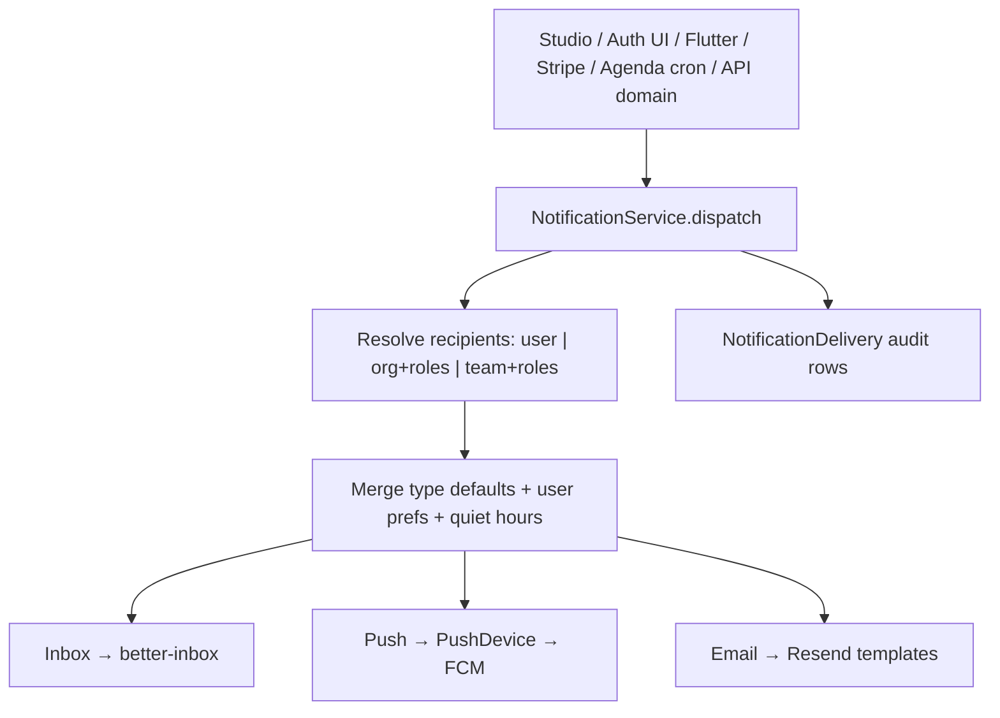

# Notifications (inbox · push · email)

Hosanna’s notification system is a **unified multi-channel dispatcher** hosted on the **auth app** (`auth.hosanna.live`). Producers (Studio, auth UI, Flutter, Stripe hooks, agenda cron, domain events) call one API; delivery fans out through **inbox**, **push (FCM)**, and **email** according to type defaults, caller overrides, and per-user preferences.

Package: [`packages/notifications`](../../packages/notifications) (`@hosanna/notifications`).

## Why it moved off the API

Identity-adjacent concerns (sessions, devices, prefs, Resend, org membership) already live on auth. Notifications, billing probes, backup, and agenda reminders now sit there too. The API keeps the music data plane and **`/api/cron/purge-trash`** only.

| Concern                                      | Host                                                             |
| -------------------------------------------- | ---------------------------------------------------------------- |
| `POST /api/notifications` (+ prefs, devices) | **auth**                                                         |
| `GET /api/billing/pricing`, `/entitlement`   | **auth**                                                         |
| `GET/POST /api/backup*`                      | **auth**                                                         |
| `GET\|POST /api/cron/agenda-reminders`       | **auth**                                                         |
| `GET\|POST /api/cron/purge-trash`            | **api**                                                          |
| Domain `notifyOrg` from API services         | in-process via `@hosanna/notifications` + slim Better Auth inbox |

## Mental model



1. **Target** resolves to a unique set of `userId`s.
2. For each user, **channels** are computed from the type catalog, optional request overrides, preferences, and quiet hours (forced security channels cannot be turned off).
3. Each enabled channel delivers independently; failures are logged per channel.

## Channels

| Channel   | Mechanism                                | Notes                                                     |
| --------- | ---------------------------------------- | --------------------------------------------------------- |
| **inbox** | `better-inbox` via `auth.api.notify`     | In-app bell; read/mark stay on Better Auth client plugins |
| **push**  | FCM HTTP v1 → **PushDevice** tokens      | Deduped by token; invalid tokens deleted                  |
| **email** | Resend + Handlebars (auth email service) | Injected into the package as `sendEmail`                  |

Legacy request field `channel: "inbox" | "push" | "both"` is still accepted and mapped to the new `channels[]` array.

## Targeting

Exactly one primary target:

- `userId` — single user
- `organizationId` (+ optional `roles[]`) — org members
- `teamId` (+ optional `roles[]`) — team members, optionally filtered by org role

## Type catalog & preferences

Code-defined types live in `@hosanna/notifications` (`NOTIFICATION_TYPES`): defaults, forced channels, category, and whether the user may override.

Examples:

- `auth.verify_email` / `auth.otp` → email only, **not** overridable
- `agenda.reminder` → push + inbox, overridable
- `billing.subscribed` → email + inbox, overridable
- Unknown types → product defaults (inbox + push)

**Preferences** (`notification_preference`):

- Global row: `type = null`, `category = null`
- Category row: e.g. `category = "agenda"`
- Type-specific row: e.g. `type = "agenda.reminder"`

Resolution order: type-specific → category → global → catalog defaults. Quiet hours suppress **push and email** only (inbox still created).

UI: personal prefs on **`/account`** (`NotificationSettingsSection`); org broadcast tools on auth org notifications + Studio settings.

## Push reliability (PushDevice)

Previously FCM tokens lived on **`Session.fcm`**. Stale tokens survived logout, app updates, and expired sessions — which is why toggling notify “fixed” push (it re-synced a fresh token).

Canonical model:

| Table                            | Role                                                                                          |
| -------------------------------- | --------------------------------------------------------------------------------------------- |
| `push_device`                    | Unique FCM `token` per device; `userId`, optional `sessionId`, `enabled`, `appId`, `platform` |
| `session.fcm` / `session.notify` | Kept temporarily for compatibility; sends no longer key off sessions                          |

Lifecycle:

1. **Register / rotate** — `POST /api/notifications/devices` (Flutter on login, token refresh, notify enable).
2. **Disable** — `DELETE /api/notifications/devices` or toggle notify off.
3. **Logout / session delete** — Better Auth `onSessionRevoked` disables devices bound to that `sessionId`.
4. **Send** — unique enabled tokens for the user; FCM `UNREGISTERED`/410 deletes the device row.
5. Migration SQL copied `Session.fcm` where `notify = true` into `push_device`.

## HTTP surface (auth host)

```
POST   /api/notifications              # dispatch (permission: notification.sent)
GET    /api/notifications/preferences  # catalog + user prefs
PATCH  /api/notifications/preferences  # upsert global/category/type prefs
POST   /api/notifications/devices      # register/rotate FCM token
DELETE /api/notifications/devices      # disable token/device
```

Example dispatch body:

```json
{
  "organizationId": "org_…",
  "roles": ["owner", "admin"],
  "type": "backup.restored",
  "title": "Backup restored",
  "body": "…",
  "href": "/organization",
  "channels": ["inbox", "email"]
}
```

Omit `channels` to use type defaults + prefs.

## Flutter (`../app`) changes

Yes — the musician app was updated:

| File                                            | Change                                                                                              |
| ----------------------------------------------- | --------------------------------------------------------------------------------------------------- |
| `lib/features/auth/data/auth_repository.dart`   | `registerPushDevice` / `disablePushDevice` → auth `/api/notifications/devices`                      |
| `lib/features/auth/domain/auth_controller.dart` | Sync/register on login & token refresh; disable on logout; `setNotify` updates PushDevice + session |

Entitlement already targeted the auth host (`GET /api/billing/entitlement`); that route now exists on auth.

Domain REST (songs, replication, etc.) still uses `HOSANNA_API_URL`.

## Producers cheat sheet

| Producer                           | How it notifies                                                        |
| ---------------------------------- | ---------------------------------------------------------------------- |
| Studio / auth org UI               | `POST {auth}/api/notifications`                                        |
| Stripe / org hooks in `createAuth` | `notifyOrg` → `NotificationService`                                    |
| Agenda cron                        | auth `/api/cron/agenda-reminders` → dispatch `agenda.reminder`         |
| API domain (e.g. folder delete)    | `@hosanna/notifications` in-process + slim BA inbox                    |
| Better Auth lifecycle emails       | Still Resend templates; security types are forced email in the catalog |

## Env (auth Vercel)

- `FCM_PROJECT_ID`, `FCM_CLIENT_EMAIL`, `FCM_PRIVATE_KEY`
- `CRON_SECRET` (agenda reminders)
- `PLAN_PRICE_*` (public pricing probe)
- Existing: `RESEND_API_KEY`, `DATABASE_URL`, Better Auth / Stripe secrets

## Related docs

- [auth-and-billing.md](./auth-and-billing.md) — Stripe + entitlement (probes on auth)
- [clients.md](./clients.md) — Studio / Flutter clients
- [external-integrations.md](./external-integrations.md) — FCM / Resend
- [data-and-sync.md](./data-and-sync.md) — backup lives on auth now
