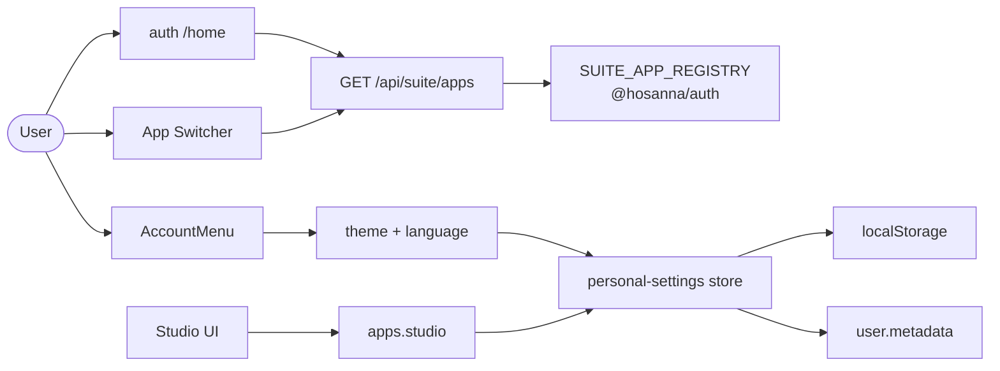

# Suite hub and personal preferences

Cross-app chrome and user preferences shared by Auth, Studio, and future suite apps. Implementation lives mainly in `@hosanna/auth`, `@hosanna/ui`, and `apps/auth`.

## Mental model



| Concern                                | Where it lives                                               | Persisted how                                              |
| -------------------------------------- | ------------------------------------------------------------ | ---------------------------------------------------------- |
| Suite product catalog                  | `@hosanna/auth` `SUITE_APP_REGISTRY` + `GET /api/suite/apps` | Server registry; clients SWR-cache the DTO                 |
| Home + App Switcher + AccountMenu      | Auth chrome + `@hosanna/ui`                                  | Session-gated catalog fetch                                |
| Theme + language                       | Core personal settings                                       | `user.metadata` + per-origin `localStorage` + theme cookie |
| App-only prefs (e.g. Studio view mode) | Registered `apps.<id>` scopes                                | Same blob; unknown scopes always preserved                 |

---

## 1. Auth home

Post-login hub on the **auth** site (not a separate suite app):

- URL: `auth.hosanna.live/home` (dev: auth app `/home`)
- Default after login and for `/` when signed in (explicit redirect query params still win)
- Header chrome: Logos AI → App Switcher → AccountMenu (org switching lives in the menu, not the header)
- Body: app grid from the suite catalog (live + coming soon), linking into each product

Product copy for the grid / switcher lives in `@hosanna/i18n` under `suite.*`.

---

## 2. Suite app catalog

**Source of truth:** `packages/auth/src/suite/apps.ts` (`SUITE_APP_REGISTRY`, `listSuiteApps`, `getSuiteApp`, `getSuiteAppUrl`).

**HTTP:** `GET /api/suite/apps` on the auth app — session-gated, CORS via `withAuthCors` so Studio (and other origins) can call it with credentials.

Each DTO includes id, status (`live` | `coming_soon`), URLs, logo (resolved via per-app `logoHost`), **accent**, and i18n keys. Clients must not hardcode the product list.

**Per-app accent:** registry `accent` hex is the source of truth. Hosts apply it with `applySuiteAppAccent(id)` / `suiteAppAccentStyle(id)` (`packages/auth/src/suite/accent.ts`), which sets `--brand-*` / `--m3-primary*`. `@hosanna/ui` already consumes those CSS variables — no per-component rewiring. Favicons live in each app’s `public/` (Auth ≠ Studio/SaaS).

**Client cache:** suite apps are fetched once per page lifetime and shared (SWR-style) between home and the App Switcher so opening the waffle does not refetch every time. Cache key / helpers live next to the UI (`suiteAppsCache` in `@hosanna/ui` / auth consumers).

---

## 3. App Switcher

Shared Google-style waffle in `@hosanna/ui`:

- Popover with greeting + app grid (same catalog as home)
- Link back to auth **home**
- Square cropped logos (`SuiteAppIcon` / brand marks) so mark artwork does not letterbox oddly
- Mounted on Auth headers and Studio address-bar chrome (AI then grid); reusable by any suite web app against the same API

---

## 4. AccountMenu

Shared account menu in `@hosanna/ui` (Auth wires it as `AuthAccountMenu`; Studio sidebar uses `variant="extended"`):

- Profile header: name + email, icon-only sign-out on the right
- Org switcher (name + `@slug` only; expands when the user has more than one org)
- Theme control (light / dark / system)
- Language control
- Links into account / org surfaces on auth
- Optional host `sections` (ReactNode or `(close) => ReactNode`) after links — Studio passes Configurations + Analysis

**Variants:** `popover` (circular avatar, Auth header) and `extended` (full-width sidebar footer row that expands upward; supports `collapsed` for the rail).

Theme and language writes go through the **personal-settings** store (below), not ad-hoc `localStorage` keys.

---

## 5. Personal settings

Package: `packages/auth/src/personal-settings/`.

One JSON blob is stored in:

1. **Better Auth `user.metadata`** (stringified JSON) — cross-origin source of truth
2. **`localStorage["personal-settings"]`** — per-origin cache for instant paint and offline edits
3. **Cookie `hosanna_color_scheme`** — theme only, shared on `.hosanna.live` for first paint across apps

Host apps call `configurePersonalSettings({ updateUserMetadata, cachedUserKey? })` once at boot (Auth providers, Studio `usePersonalSettings`). Writes debounce (~300ms) into metadata and keep the cached session user warm when `cachedUserKey` is set.

### 5.1 Core (shared) keys

Only cross-app prefs live at the root:

```json
{
  "theme": "dark",
  "language": "en",
  "apps": {}
}
```

- `theme`: `"light" | "dark" | "system"`
- `language`: `"pt" | "en" | "es" | "auto"`
- `CROSS_APP_KEYS` drives `syncSettingsFromMetadata` so a change on Studio shows up on Auth (and the reverse) without wiping localStorage

**First paint:** `buildThemeBootScript()` (Auth layout / Studio `index.html`) reads personal-settings → optional legacy keys → cookie → default light, then toggles `.dark` before paint.

**Transitions:** `runThemeTransition` prefers the View Transition API (root crossfade ~220ms). CSS fallback only on `html`/`body` via `html.theme-transition` — never a universal `*` transition (that was laggy and fought VT).

**Safe writes:** `updatePersonalSettingsSafe(patch, { readRemoteMetadata })` merges remote metadata before patching so Auth cannot clobber Studio `apps.*` (and the reverse). Prefer this for theme/language toggles.

**Logout:** `clearPersonalSettingsCache()` drops the device cache; next login rehydrates from metadata.

**bfcache:** `pageshow` (persisted) reloads from local cache via `reloadPersonalSettingsFromCache`.

### 5.2 Scoped app settings registry

App-specific prefs must **not** sit on the root blob. Each app registers a typed scope under `apps.<id>`.

```ts
import {
  defineAppSettingsScope,
  registerAppSettingsScope,
  createAppSettingsAccessor,
} from "@hosanna/auth";

export const myScope = defineAppSettingsScope({
  id: "planning", // unique suite app id
  defaults: {
    weekStartsOn: 0,
    compactAgenda: false,
  },
  // Optional: lift old flat root keys (or other legacy shapes) once
  migrateFromRoot: (root) => {
    const out: Record<string, unknown> = {};
    if (typeof root.weekStartsOn === "number") out.weekStartsOn = root.weekStartsOn;
    return out;
  },
});

registerAppSettingsScope(myScope);

export const planningSettings = createAppSettingsAccessor(myScope);
// planningSettings.get() / .set(patch) / .setKey(k, v) / .subscribe(fn)
```

**API surface** (`@hosanna/auth`):

| API                                                            | Role                                                     |
| -------------------------------------------------------------- | -------------------------------------------------------- |
| `defineAppSettingsScope`                                       | Typed definition (defaults + optional migration)         |
| `registerAppSettingsScope`                                     | Idempotent register; re-runs flat→nested migration       |
| `getAppSettings` / `updateAppSetting(s)`                       | Read/write with cache + debounced metadata sync          |
| `updateAppSettingsSafe`                                        | Merge remote `apps` before write                         |
| `subscribeAppSettings`                                         | Scope-filtered listener for React `useSyncExternalStore` |
| `createAppSettingsAccessor`                                    | Stable `{ get, set, setKey, subscribe }` bundle          |
| `mergeAppSettingsMaps` / `mergePersonalSettingsPreservingApps` | Used internally; **unknown scopes are always kept**      |

**Invariant:** registration is for defaults, types, and migration — **not** permission to keep data. Auth never registers `studio`, but every Auth theme write must still preserve `apps.studio` when merging metadata.

### 5.3 Studio scope (reference implementation)

[`apps/studio/src/lib/studioSettings.ts`](../../apps/studio/src/lib/studioSettings.ts) registers `id: "studio"` with:

- Explorer: `viewMode`, `explorerDensity`, `showSongScore`, `songScoreLayout`
- Chrome: `showFolderTree`, `showChordsDefault`, `sidebarCollapsed`
- Tours: `productTourCompleted`, `productTourDismissedAt`, `interactiveOnboardingCompleted`

React: `useStudioSettings()` (also re-exported from `hooks/usePersonalSettings` for convenience).  
Core theme/language: keep using `usePersonalSettings()` / Auth `ThemeProvider` + `I18nProvider`.

Example stored blob after Studio has run:

```json
{
  "theme": "system",
  "language": "pt",
  "apps": {
    "studio": {
      "viewMode": "list",
      "explorerDensity": "compact",
      "showSongScore": true,
      "songScoreLayout": "ring",
      "showFolderTree": true,
      "showChordsDefault": true,
      "sidebarCollapsed": false,
      "productTourCompleted": true,
      "productTourDismissedAt": null,
      "interactiveOnboardingCompleted": false
    }
  }
}
```

### 5.4 Adding prefs for a new suite app

1. Define + register a scope in that app’s boot path (same process as Studio).
2. Put **only** that app’s keys in `defaults` / `migrateFromRoot`.
3. Use `createAppSettingsAccessor` + `useSyncExternalStore` (or call get/set directly).
4. Do **not** add app keys to root `PersonalSettings` / `DEFAULT_PERSONAL_SETTINGS`.
5. Confirm Auth (or any other app) still round-trips metadata without stripping your `apps.<id>` — use `updatePersonalSettingsSafe` / `updateAppSettingsSafe` for cross-app writes.

---

## 6. Key files

| Area                               | Path                                            |
| ---------------------------------- | ----------------------------------------------- |
| Suite registry                     | `packages/auth/src/suite/apps.ts`               |
| Catalog API                        | `apps/auth/app/api/suite/apps/route.ts`         |
| Home UI                            | `apps/auth` home shell / pages                  |
| App Switcher / AccountMenu / icons | `packages/ui`                                   |
| Personal settings store            | `packages/auth/src/personal-settings/store.ts`  |
| Scope registry                     | `packages/auth/src/personal-settings/scopes.ts` |
| Theme boot / transitions           | `packages/auth/src/personal-settings/theme.ts`  |
| Studio scope                       | `apps/studio/src/lib/studioSettings.ts`         |
| Auth configure host                | `apps/auth/components/providers.tsx`            |
| Studio configure host              | `apps/studio/src/hooks/usePersonalSettings.tsx` |

Product-level intent for home + switcher also appears in [FUTURE_DIRECTION.md](../FUTURE_DIRECTION.md) §4.1.
